<picture>
  <source media="(max-width: 600px) and (prefers-color-scheme: dark)" srcset="./assets/lab/hero-dark-mobile.png">
  <source media="(max-width: 600px) and (prefers-color-scheme: light)" srcset="./assets/lab/hero-light-mobile.png">
  <source media="(prefers-color-scheme: dark)" srcset="./assets/lab/hero-dark.png">
  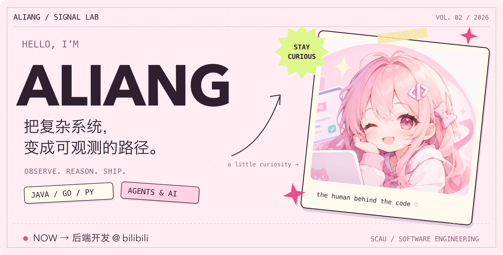
</picture>

  <b>把复杂系统，变成可观测的路径。</b> 
  我是阿亮，华南农业大学软件工程专业的学生。 
  主线是后端开发，也在探索 Agent 怎样真正连接工具、知识与业务；同时保留 HTML、CSS、JavaScript、Vue 的前端实践。

  <a href="https://zxlyyds100.github.io/ZXLyyds100/"><b>进入我的交互主页 ↗</b></a>

<picture>
  <source media="(max-width: 600px) and (prefers-color-scheme: dark)" srcset="./assets/lab/signal-core-dark-mobile.gif">
  <source media="(max-width: 600px) and (prefers-color-scheme: light)" srcset="./assets/lab/signal-core-light-mobile.gif">
  <source media="(prefers-color-scheme: dark)" srcset="./assets/lab/signal-core-dark.gif">
  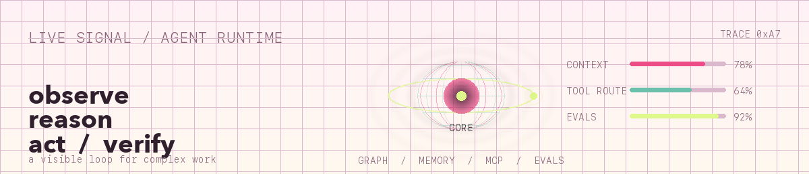
</picture>

  
  
  

 

<picture>
  <source media="(max-width: 600px) and (prefers-color-scheme: dark)" srcset="./assets/lab/csdn-dashboard-dark-mobile.png">
  <source media="(max-width: 600px) and (prefers-color-scheme: light)" srcset="./assets/lab/csdn-dashboard-light-mobile.png">
  <source media="(prefers-color-scheme: dark)" srcset="./assets/lab/csdn-dashboard-dark.png">
  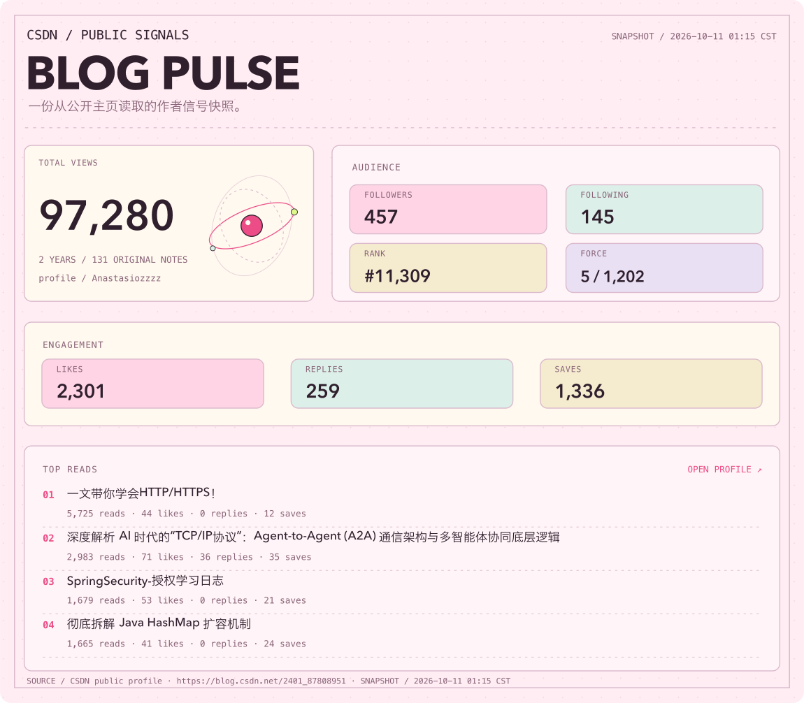
</picture>

  <a href="https://blog.csdn.net/2401_87808951"><b>打开 CSDN 主页 ↗</b></a>
  &nbsp; / &nbsp;
  数据来自公开主页快照，更新时间见图中标注

 

<picture>
  <source media="(max-width: 600px) and (prefers-color-scheme: dark)" srcset="./assets/lab/toolbox-dark-mobile.png">
  <source media="(max-width: 600px) and (prefers-color-scheme: light)" srcset="./assets/lab/toolbox-light-mobile.png">
  <source media="(prefers-color-scheme: dark)" srcset="./assets/lab/toolbox-dark.png">
  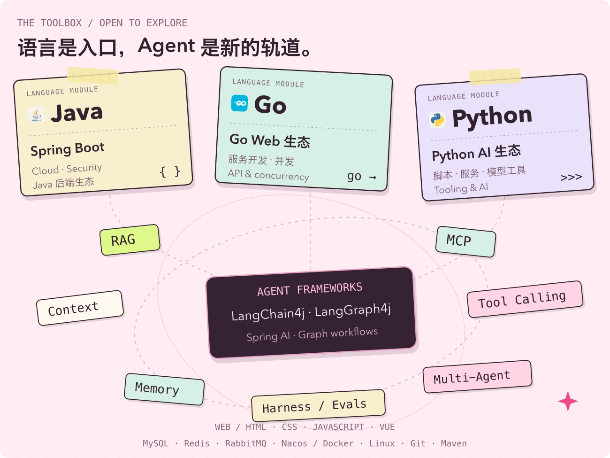
</picture>

  
<b>想看具体技术？打开这个抽屉。</b>

   
  
<b>Java：</b>Spring · Spring Boot · Spring Cloud · Spring Security。

  
<b>Go：</b>服务开发、Web API 与并发。

  
<b>Python：</b>脚本、服务与 AI 应用工具。

  
<b>Web：</b>HTML · CSS · JavaScript · Vue，页面结构、样式与交互实践。

  
<b>Agent 框架与编排：</b>LangChain4j · LangGraph4j · Spring AI · Graph 工作流。

  
<b>正在关注的 Agent 概念：</b>RAG、MCP、工具调用、上下文工程、记忆、多智能体协作、Harness Engineering、评估与可观测性。

  
<b>后端基础设施：</b>MySQL · Redis · RabbitMQ · Nacos · Docker · Linux · Git · Maven。

  
<b>其他接触过的技术：</b>C · C++ · GraphQL。

 

<picture>
  <source media="(max-width: 600px) and (prefers-color-scheme: dark)" srcset="./assets/lab/label-journey-dark-mobile.png">
  <source media="(max-width: 600px) and (prefers-color-scheme: light)" srcset="./assets/lab/label-journey-light-mobile.png">
  <source media="(prefers-color-scheme: dark)" srcset="./assets/lab/label-journey-dark.png">
  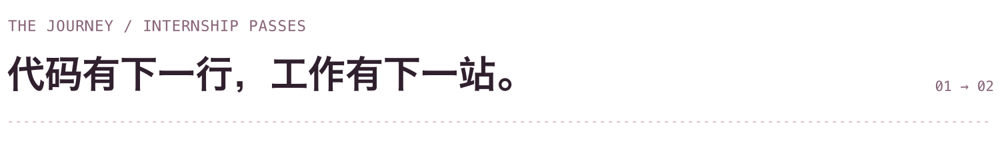
</picture>

<picture>
  <source media="(max-width: 600px)" srcset="./assets/lab/ticket-bilibili-mobile.png">
  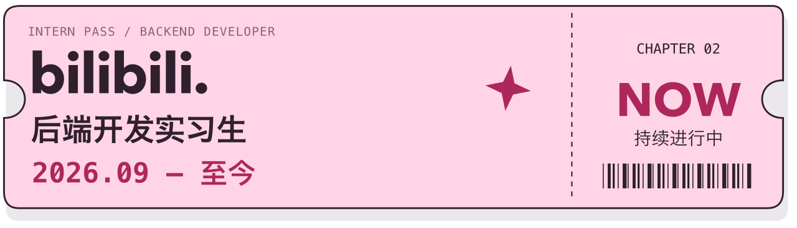
</picture>

<picture>
  <source media="(max-width: 600px)" srcset="./assets/lab/ticket-oneway-mobile.png">
  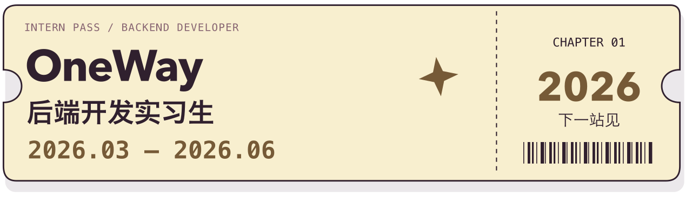
</picture>

  
展开实习记录。

   
  
<b>哔哩哔哩 / bilibili：</b>后端开发实习生 · 2026 年 9 月至今。

  
<b>OneWay：</b>后端开发实习生 · 2026 年 3 月至 6 月。

 

<picture>
  <source media="(max-width: 600px) and (prefers-color-scheme: dark)" srcset="./assets/lab/label-writing-dark-mobile.png">
  <source media="(max-width: 600px) and (prefers-color-scheme: light)" srcset="./assets/lab/label-writing-light-mobile.png">
  <source media="(prefers-color-scheme: dark)" srcset="./assets/lab/label-writing-dark.png">
  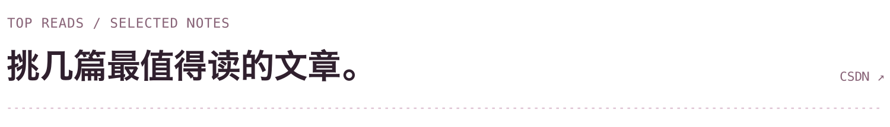
</picture>

  <a href="https://blog.csdn.net/2401_87808951/article/details/148381498">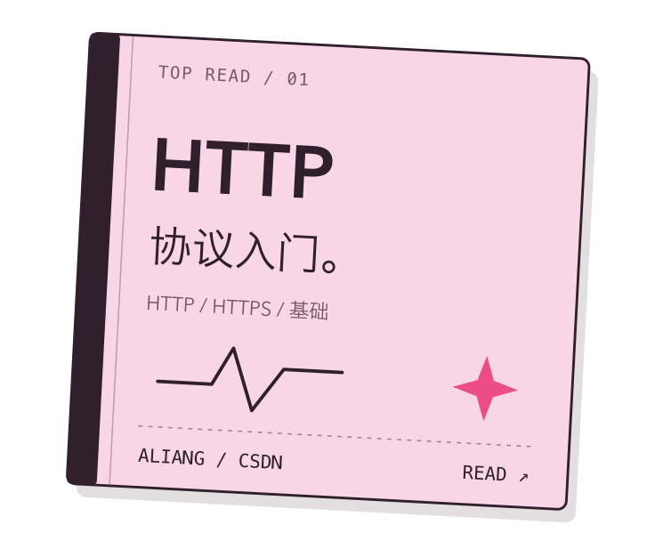</a>
  <a href="https://blog.csdn.net/2401_87808951/article/details/161172398">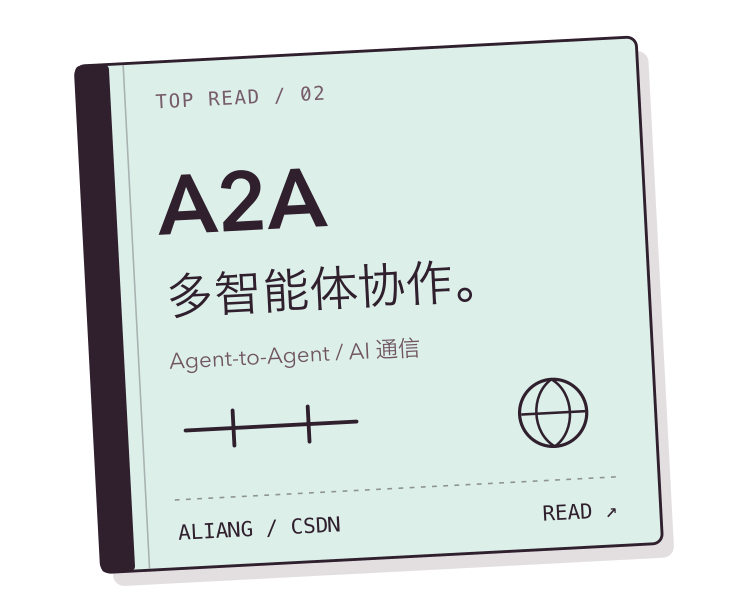</a>

  <a href="https://blog.csdn.net/2401_87808951/article/details/147925626">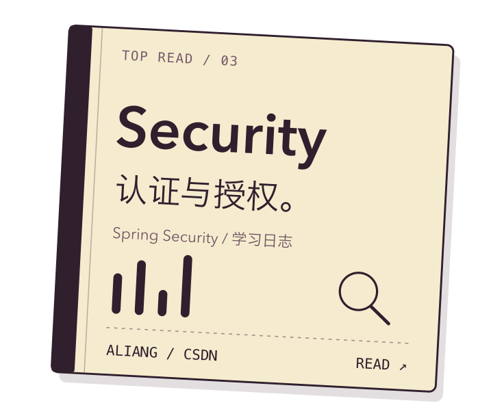</a>
  <a href="https://blog.csdn.net/2401_87808951/article/details/157872627">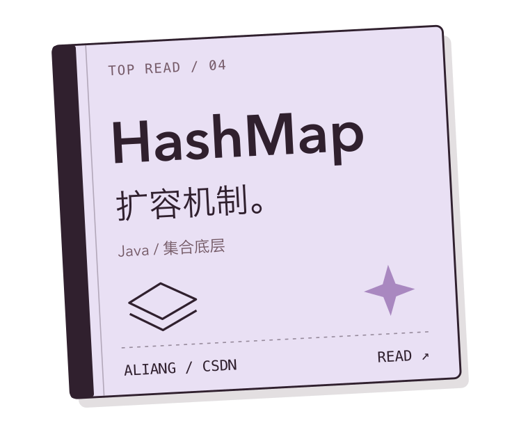</a>

  <a href="https://blog.csdn.net/2401_87808951"><b>去 CSDN，继续翻翻我的笔记 ↗</b></a>

  
直接读文章，也可以。

   
  
<a href="https://blog.csdn.net/2401_87808951/article/details/148381498">一文带你学会HTTP/HTTPS！</a>

  
<a href="https://blog.csdn.net/2401_87808951/article/details/161172398">深度解析 AI 时代的“TCP/IP协议”：Agent-to-Agent (A2A) 通信架构与多智能体协同底层逻辑</a>

  
<a href="https://blog.csdn.net/2401_87808951/article/details/147925626">SpringSecurity-授权学习日志</a>

  
<a href="https://blog.csdn.net/2401_87808951/article/details/157872627">彻底拆解 Java HashMap 扩容机制</a>

  
顺便，仓库里还放了一些实验。

   
  
<a href="https://github.com/ZXLyyds100/FlowCopilot">FlowCopilot</a> · 多 Agent 任务协作与交付的探索。

  
<a href="https://github.com/ZXLyyds100/LangChain4j-AI-Chat-Demo">LangChain4j AI Chat Demo</a> · Java 生态的 AI 对话应用实验。

  
<a href="https://github.com/ZXLyyds100?tab=repositories">浏览全部仓库 ↗</a>

 

<picture>
  <source media="(max-width: 600px) and (prefers-color-scheme: dark)" srcset="./assets/lab/footer-dark-mobile.png">
  <source media="(max-width: 600px) and (prefers-color-scheme: light)" srcset="./assets/lab/footer-light-mobile.png">
  <source media="(prefers-color-scheme: dark)" srcset="./assets/lab/footer-dark.png">
  
</picture>

  <a href="https://github.com/ZXLyyds100">GitHub ↗</a>
  &nbsp; / &nbsp;
  <a href="https://blog.csdn.net/2401_87808951">CSDN ↗</a>
  &nbsp; / &nbsp;
  <a href="mailto:Zxl2024903531@outlook.com">Email ↗</a>

