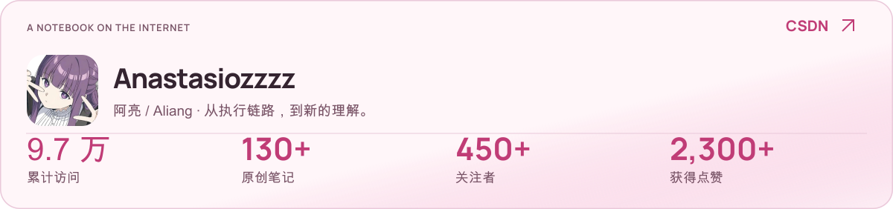
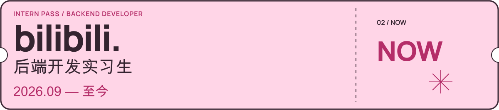
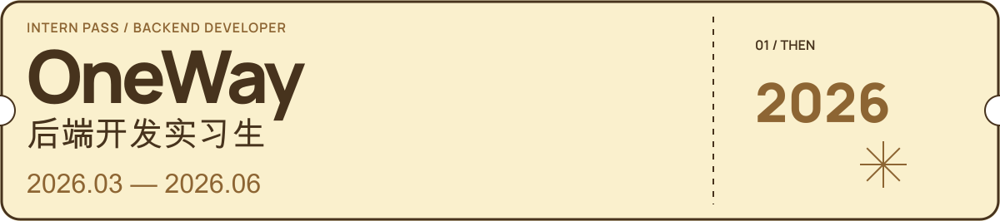

<!-- signal-lab-profile: signal-lab-20261012-dd8bd9719d1c -->

<a href="https://zxlyyds100.github.io/ZXLyyds100/#companion">
  <picture>
    <source media="(max-width: 600px) and (prefers-reduced-motion: reduce) and (prefers-color-scheme: dark)" srcset="./assets/readme-v2/hero-still-dark-mobile-9b7fa6aed7.svg">
    <source media="(max-width: 600px) and (prefers-reduced-motion: reduce)" srcset="./assets/readme-v2/hero-still-light-mobile-96fd453d55.svg">
    <source media="(prefers-reduced-motion: reduce) and (prefers-color-scheme: dark)" srcset="./assets/readme-v2/hero-still-dark-758d142de9.svg">
    <source media="(prefers-reduced-motion: reduce)" srcset="./assets/readme-v2/hero-still-light-60690b62e9.svg">
    <source media="(max-width: 600px) and (prefers-color-scheme: dark)" srcset="./assets/readme-v2/hero-dark-mobile-0d6f1233a0.svg">
    <source media="(max-width: 600px)" srcset="./assets/readme-v2/hero-light-mobile-c4db941a63.svg">
    <source media="(prefers-color-scheme: dark)" srcset="./assets/readme-v2/hero-dark-45793dbe2b.svg">
    
  </picture>
</a>

  <b>嗨，我是阿亮！</b> 
  SCAU 软件工程在读，主攻后端与 Agent，也熟悉前端技术栈。 
  正在努力实习中～ 一边写代码，一边涨经验，持续升级，也继续折腾有意思的新东西。

  <a href="https://zxlyyds100.github.io/ZXLyyds100/"><b>进入我的交互主页 ↗</b></a>
  &nbsp; · &nbsp;
  <a href="https://zxlyyds100.github.io/ZXLyyds100/#companion">和小像打个招呼 ♡</a>
  &nbsp; · &nbsp;
  <a href="https://blog.csdn.net/2401_87808951">翻翻我的笔记 ↗</a>

  <a href="https://zxlyyds100.github.io/ZXLyyds100/#companion">
    <picture>
      <source media="(prefers-reduced-motion: reduce)" srcset="./assets/readme-v2/companion-still-c56f963575.png">
      
    </picture>
  </a> 
  角色动图预览 · 在网页里，摸摸头、戳戳脸，和她打个招呼 ♡

### 写代码，也把过程记下来。

<a href="https://blog.csdn.net/2401_87808951">
  <picture>
    <source media="(max-width: 600px) and (prefers-color-scheme: dark)" srcset="./assets/readme-v2/blog-dark-mobile-811d5cbeef.svg">
    <source media="(max-width: 600px)" srcset="./assets/readme-v2/blog-light-mobile-25b5cfc2e6.svg">
    <source media="(prefers-color-scheme: dark)" srcset="./assets/readme-v2/blog-dark-9e41930bbe.svg">
    
  </picture>
</a>

公开资料的大致概览，不是实时统计；最新文章与数字以 [CSDN 主页](https://blog.csdn.net/2401_87808951) 为准。

几篇可以先读的笔记：

- [HTTP / HTTPS：从请求到安全](https://blog.csdn.net/2401_87808951/article/details/148381498)
- [A2A：多智能体如何真正协同](https://blog.csdn.net/2401_87808951/article/details/161172398)
- [Spring Security：沿着执行链路理解授权](https://blog.csdn.net/2401_87808951/article/details/147925626)
- [HashMap 扩容：拆开看才明白](https://blog.csdn.net/2401_87808951/article/details/157872627)

### 把复杂，拆成有序。

后端是主线，Agent 是正在探索的方向，前端是把想法做成可用交互的另一套工具。

  
<b>打开我的技术工具盒</b>

   
  
<b>Java：</b>Spring · Spring Boot · Spring Cloud · Spring Security。

  
<b>Go：</b>服务开发、Web API 与并发。

  
<b>Python：</b>脚本、服务与 AI 应用工具。

  
<b>Web：</b>HTML · CSS · JavaScript · Vue。

  
<b>Agent 框架与编排：</b>LangChain4j · LangGraph4j · Spring AI · Graph 工作流。

  
<b>正在关注：</b>RAG、MCP、工具调用、上下文工程、记忆、多智能体协作、Harness、评估与可观测性。

  
<b>基础设施：</b>MySQL · Redis · RabbitMQ · Nacos · Docker · Linux · Git · Maven。

  
<b>其他接触过：</b>C · C++ · GraphQL。

### 代码有下一行，工作有下一站。

<picture>
  <source media="(max-width: 600px)" srcset="./assets/readme-v2/ticket-bilibili-mobile-0900b99eb0.svg">
  
</picture>

 

<picture>
  <source media="(max-width: 600px)" srcset="./assets/readme-v2/ticket-oneway-mobile-bc0b53942d.svg">
  
</picture>

  
一些还在继续的实验

   
  
<a href="https://github.com/ZXLyyds100/FlowCopilot">FlowCopilot</a> · 多 Agent 任务协作与交付的探索。

  
<a href="https://github.com/ZXLyyds100/LangChain4j-AI-Chat-Demo">LangChain4j AI Chat Demo</a> · Java 生态的 AI 对话应用实验。

  
<a href="https://github.com/ZXLyyds100?tab=repositories">浏览全部仓库 ↗</a>

---

  <b>写代码，也留一点时间打羽毛球。</b> 
  欢迎聊聊后端开发、Agent 与 AI 应用。

  <a href="https://github.com/ZXLyyds100">GitHub ↗</a>
  &nbsp; / &nbsp;
  <a href="https://blog.csdn.net/2401_87808951">CSDN ↗</a>
  &nbsp; / &nbsp;
  <a href="mailto:Zxl2024903531@outlook.com">Email ↗</a>

